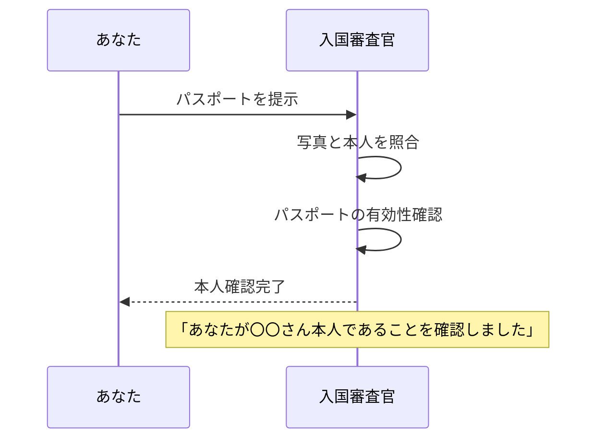
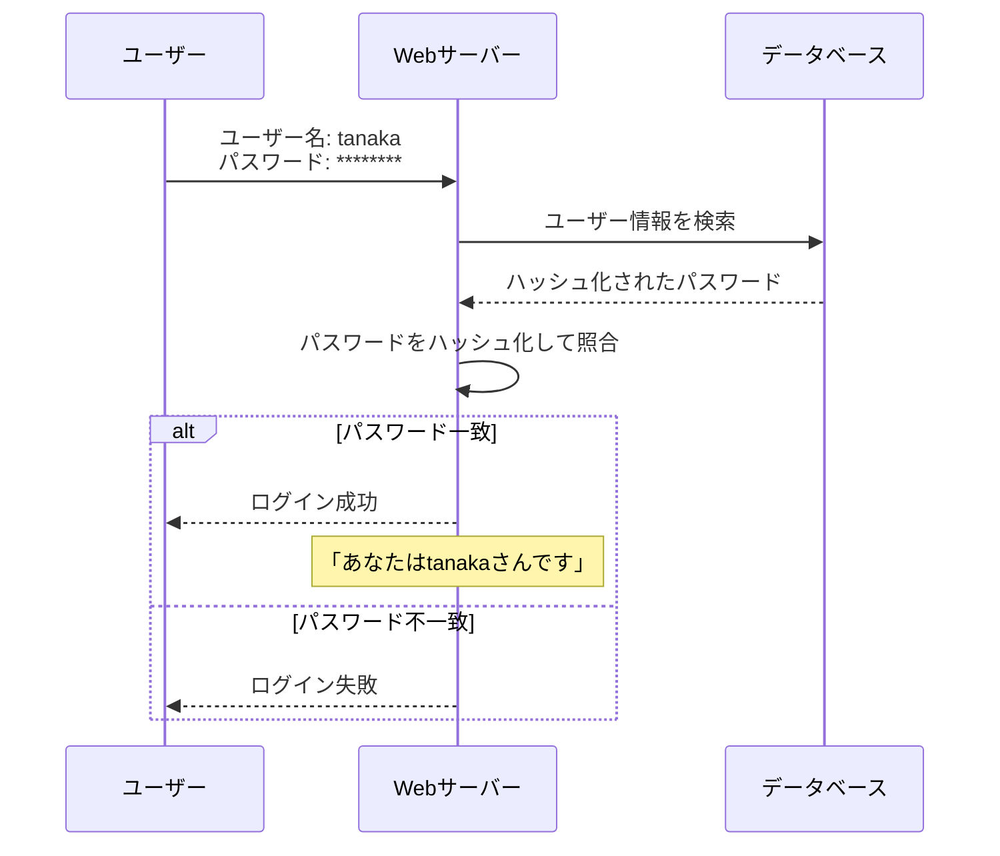
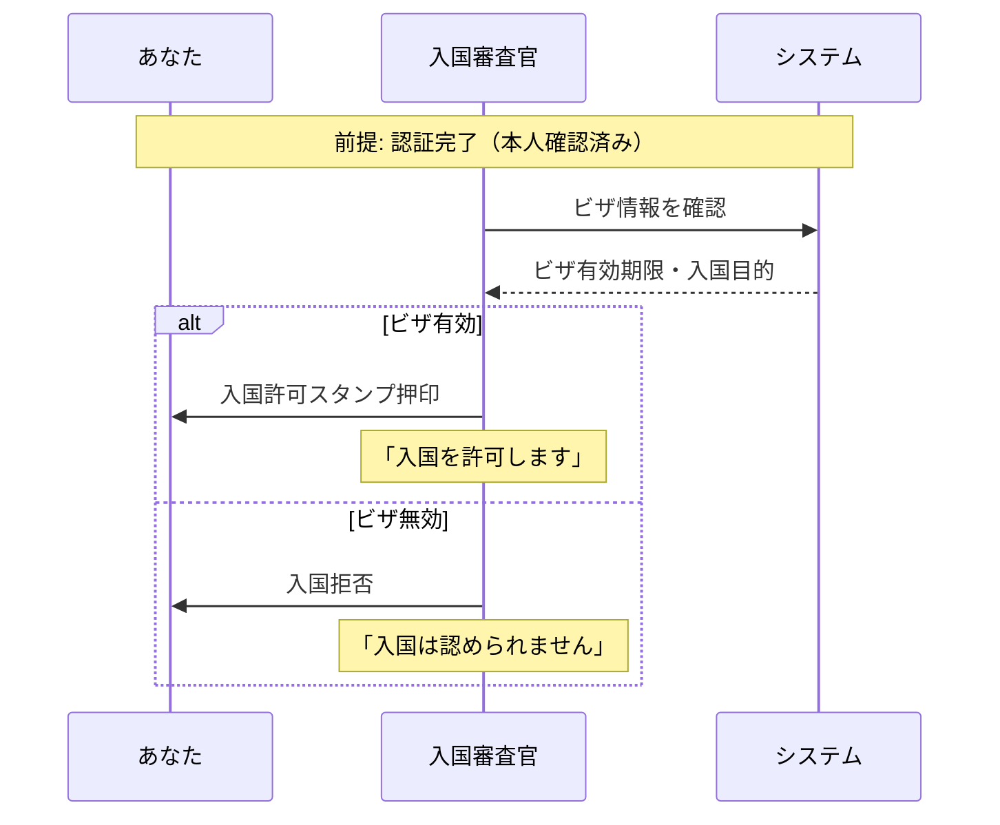
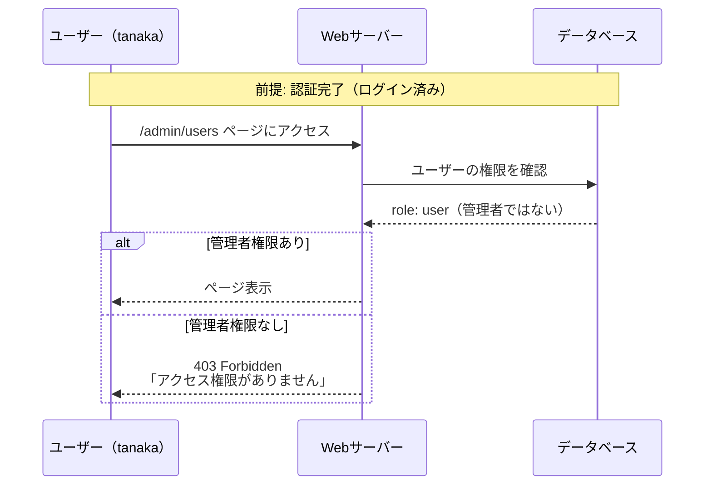
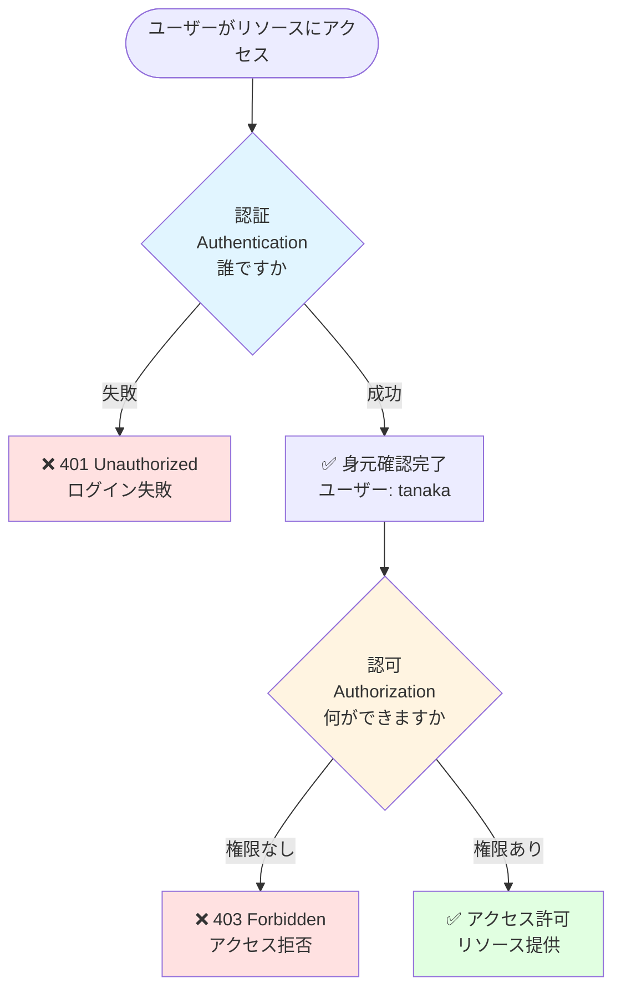

セキュリティの文脈でよく認証と認可という言葉が出てきますが、これらは全く異なる概念です。この章ではそれぞれの内容とその違いをまとめていきます。

:::message
英語ではauthentication(認証)とauthorization(認可)で略してどちらもauthになってしまうためタチが悪いですね。
:::

## 認証（Authentication）とは

「あなたは誰ですか？」という問いに答えるプロセスです。

ユーザーやシステムが主張する身元（アイデンティティ）が正しいことを確認します。例えると以下のような感じです。

### 具体例

#### 例1: 空港の入国審査

#### 例2: Webサイトへのログイン

:::message
後述はしますが、身元を確認しているだけなことに注意です。確認後に入国を許可するであったり、apiアクセスを許可するプロセスは認可にあたります。
:::

### 認証の方法（認証要素）

認証は以下の3つの要素の組み合わせで行なわれます

| 要素                                    | 内容                   | 具体例                                         |
| --------------------------------------- | ---------------------- | ---------------------------------------------- |
| **知識要素** （Something you know） | あなたが知っている情報 | パスワード、PIN、秘密の質問                    |
| **所持要素** （Something you have） | あなたが持っているもの | スマートフォン、ICカード、セキュリティトークン |
| **生体要素** （Something you are）  | あなた自身の身体的特徴 | 指紋、顔認証、虹彩認証                         |

ついでに多要素認証・2段階認証についても説明しておきます。

#### 多要素認証（MFA）

複数の**要素**を組み合わせることでセキュリティを強化します。例えば

1. パスワード入力（知識要素）
2. スマートフォンに確認コード送信（所持要素）
3. ログイン成功

:::message
この例は、異なる要素（知識要素と所持要素）を組み合わせているため、**多要素認証**であり、かつ2回の認証ステップを踏むため**2段階認証**でもあります。
:::

#### 2段階認証

**2段階認証**は、認証プロセスを2回に分けて行なう方式です。必ずしも異なる要素を組み合わせる必要はありません。

例：

- 1段階目: パスワード入力（知識要素）
- 2段階目: 秘密の質問（知識要素）← 同じ要素でも2段階認証

#### 多要素認証と2段階認証の違い

- **多要素認証**: 異なる**要素**を組み合わせる（より安全）
- **2段階認証**: 認証を2段階に分けて行なう（要素は同じでもよい）

基本的に一番セキュアなのは「多要素認証かつ2段階認証」ということになります。

## 認可（Authorization）とは

「あなたは何ができますか？」という問いに答えるプロセスです。

認証済みのユーザーが特定のリソースやアクションにアクセスする権限を持っているかを確認します。例えると以下のような感じです。

### 具体例

#### 例1: 空港の入国審査（続き）

認証後の認可プロセスを見てみましょう。

:::message
認証で本人確認ができても、ビザ（入国の権限）がなければ入国できません。これが認可です。
:::

#### 例2: Webサイトへのログイン（続き）

認証後の認可プロセスを見てみましょう。

:::message
ログイン（認証）に成功しても、管理者ページへのアクセス権限（認可）がなければアクセスできません。
:::

## 認証と認可の関係

認証と認可は一般的に以下のような関係性(プロセス)なことが多いです。

### フロー図

ここで重要なのは以下の3点です。

1. **認証は認可の前提条件**
   - 認可を行なうには、まず誰がアクセスしようとしているか（認証）を知る必要がある

2. **認証成功 ≠ アクセス許可**
   - 身元が確認されても、そのリソースへのアクセス権限がなければアクセスできない

3. **認可には必ず認証が必要**
   - 誰だかわからない相手に権限を与えることはできない

## 次のステップ

認証と認可の違いを理解したら、次は認証認可で使われる代表的なプロトコルを次回以降で説明していきます。

- **OAuth2.0**: 認可のための標準プロトコル
- **OpenID Connect**: OAuth2.0をベースにした認証プロトコル
- **SAML**: エンタープライズ向けのSSO認証プロトコル
