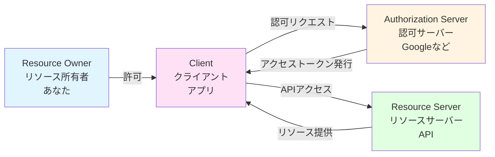
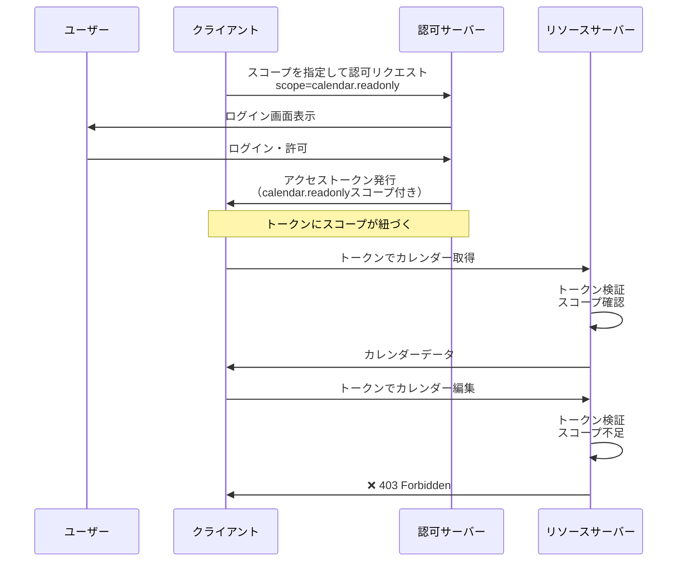
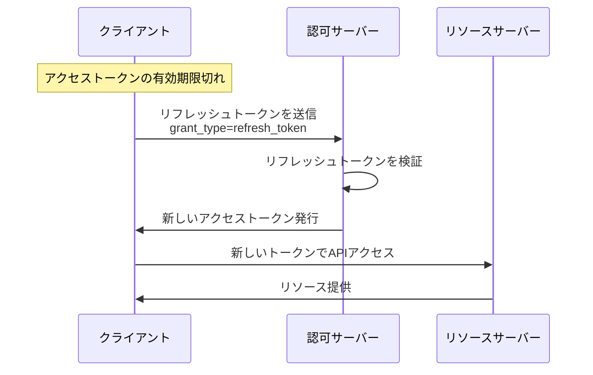
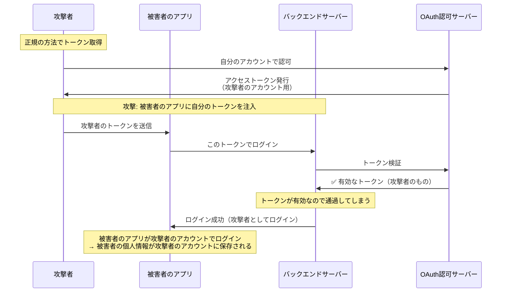

はじめにことわっておきますが、OAuth2.0は認可を実現するためのプロトコルです。

:::message
OAuth認証という言葉が1人歩きしてしまっているため勘違いされがちです。
:::

OAuth2.0を認証に使うことは可能ですが、**そのままでは不十分でセキュリティリスクがあります**。認証には**OpenID Connect**や**SAML**などの認証プロトコルを使うべきです。

## OAuth2.0が解決する問題

そもそもOAuth2.0はどういうことを解決するための認可プロトコルなのでしょうか？
何も考えなければ、パスワードとかで認証されたユーザーに対して操作の認可があったそれでよくない？　となります。しかし以下のような問題があります。

### 問題: パスワード共有の危険性

あなたがGoogleカレンダーの予定を自動的に分析して通知してくれるアプリを使いたいとします。

OAuth2.0が登場する前は、先ほど紹介したように、以下のような方法で実現できます。

1. ユーザーがアプリにGoogleのメールアドレスとパスワードを教える
2. アプリがユーザーのパスワードを保存
3. アプリがユーザーのアカウントで直接ログイン

しかしこの方法にはよく考えるといくつか以下のような問題があります。

1. **パスワード漏洩リスク**
   - アプリにパスワードを渡すため、アプリが悪意を持っていたらアカウントが乗っ取られる
   - アプリのサーバーがハッキングされたら全ユーザーのパスワードが漏洩

2. **過剰な権限**
   - パスワードを知ってしまったアプリはカレンダーの読み取りだけでなく、予定削除、Gmail送信、ドライブファイル削除まで何でもできる
   - 権限の制限ができない

3. **取り消しが困難**
   - アプリの利用をやめたい場合、パスワード変更が必要(アプリそばが自由にずっとユーザーのgoogleアカウントに入れてしまうため)

## OAuth2.0による解決

OAuth2.0は上のような問題を解決するために、**パスワードを共有せず**、**限定的な権限**を**一時的**に与えるというプロセスをプロトコルとして定めてます。

## OAuth2.0の内容

ではどのようなプロトコルなのかもう少し詳細を見ていきます。

### OAuth2.0の登場人物

OAuth2.0には4つの役割（ロール）があります：



:::message
実際のフローはもう少し複雑です。次のチャプターで説明します。
:::

### 1. Resource Owner（リソース所有者）

- **役割**: 保護されたリソースの所有者
- **具体例**: あなた（エンドユーザー）

クライアントにリソースへのアクセスを許可してあげる役目です。

以下のような画面が出てきて、許可してあげた経験があると思います。


### 2. Client（クライアント）

- **役割**: リソースにアクセスしたいアプリケーション
- **具体例**: カレンダー分析アプリ、タスク管理アプリ、写真編集アプリ

リソース所有者に代わってリソースサーバーにアクセスする何かしらのアプリやシステムです。

### 3. Authorization Server（認可サーバー）

- **役割**: リソース所有者を認証し、アクセストークンを発行
- **具体例**: Google OAuth 2.0サーバー、GitHub OAuth等

以下を行なう役目です。

- リソース所有者の認証
- クライアントの認証
- アクセストークンの発行
- リフレッシュトークンの発行

### 4. Resource Server（リソースサーバー）

- **役割**: 保護されたリソースを提供するサーバー
- **具体例**: Google Calendar API、Google Drive API、Gmail API

アクセストークンを検証し、リソースを返す役目です。

:::message
**注意**: 実際のサービスでは、認可サーバーとリソースサーバーは同じ組織（例：Google）が提供していることが多いです。そのため、ユーザーからは同じものに見えますが、OAuth2.0の仕組み上は役割が異なります。

例：Googleの場合

- 認可サーバー: `https://accounts.google.com`（トークン発行）
- リソースサーバー: `https://www.googleapis.com`（APIを提供）

:::

### アクセストークンとスコープについて

#### アクセストークンとは

アクセストークン（Access Token）は、リソースサーバーへのアクセス権を証明する文字列です。

- **目的**: リソースサーバーへのアクセスに使用
- **有効期限**: 短い（1時間程度）
- **形式**: Opaque Token（ランダム文字列）またはJWT（JSON Web Token）等

**使用例:**

```http
GET /calendar/v3/calendars/primary/events HTTP/1.1
Host: www.googleapis.com
Authorization: Bearer ya29.a0AfH6SMBx...
```

#### スコープ（Scope）とは

**スコープ**は、アクセストークンがアクセスできるリソースの範囲を定義します。

```javascript
// Google API のスコープの例(サンプルです)
const SCOPES = {
  'https://www.googleapis.com/auth/calendar.readonly': {
    description: 'Googleカレンダーの閲覧',
    resources: ['GET /calendar/v3/calendars/primary/events']
  },
  'https://www.googleapis.com/auth/calendar': {
    description: 'Googleカレンダーの閲覧と編集',
    resources: [
      'GET /calendar/v3/calendars/primary/events',
      'POST /calendar/v3/calendars/primary/events',
      'DELETE /calendar/v3/calendars/primary/events/{eventId}'
    ]
  }
}
```

### アクセストークン + スコープの関係



:::message
アクセストークンは、発行時に指定されたスコープと紐づけられます。そのため、トークンを持っていても、スコープで許可されていない操作はできません。
:::

### リフレッシュトークンについて

アクセストークンは有効期限が短いため、長期間アクセスを維持するにはリフレッシュトークン（Refresh Token）を使用します。

- **目的**: アクセストークンの更新に使用
- **有効期限**: 長い（30日〜無期限）

### リフレッシュフローの流れ



以下にリフレッシュする実装例を示します。

```javascript
async function refreshAccessToken(refreshToken) {
  const response = await fetch('https://oauth2.googleapis.com/token', {
    method: 'POST',
    headers: {
      'Content-Type': 'application/x-www-form-urlencoded'
    },
    body: new URLSearchParams({
      grant_type: 'refresh_token',
      refresh_token: refreshToken,
      client_id: 'abc123xyz',
      client_secret: 'secret_xyz789abc'
    })
  })

  const data = await response.json()

  return {
    accessToken: data.access_token,
    refreshToken: data.refresh_token, // 新しいリフレッシュトークン（場合による）
    expiresIn: data.expires_in
  }
}
```

### OAuth2.0の内容まとめ

ここまでの内容をまとめると、OAuth2.0は以下のような仕組みです：

#### OAuth2.0 = パスワードを渡さずに、限定的な権限を一時的に委譲する認可のプロトコル

- **4つの登場人物**: リソース所有者（あなた）、クライアント（アプリ）、認可サーバー（Google等）、リソースサーバー（API）
- **アクセストークン**: リソースへのアクセス権を証明する文字列（有効期限が短い）
- **スコープ**: トークンがアクセスできる範囲を限定する（例：カレンダーの閲覧のみ）
- **リフレッシュトークン**: アクセストークンを更新するための長期有効なトークン

これにより、**パスワード漏洩リスク**、**過剰な権限**、**取り消しの困難さ**という問題を解決しています。

ただし、OAuth2.0は**認可のためのプロトコル**であり、認証には不十分です。次のセクションでその理由を説明します。

## OAuth2.0は「認証」ではないということについて

冒頭でも説明しましたが、OAuth2.0は**API保護を目的とした認可プロトコル**であり、認証プロトコルではありません。しかし「OAuth認証」という言葉の誤用により、OAuth2.0を認証に使おうとするケースが多く見られます。

### なぜOAuth2.0は認証に使えないのか？

#### 1. アクセストークンは「誰」を証明しない

OAuth2.0のアクセストークン（Bearer Token）は、**リソースサーバーがリソースへのアクセスを検証するためのもの**であり、クライアントに認証情報を伝えるために設計されていません。

```javascript
// アクセストークンに含まれる情報
{
  "token": "ya29.a0AfH6SMBx...",
  "scope": "https://www.googleapis.com/auth/calendar.readonly",
  "expires_in": 3600
  // 問題: ユーザーIDは含まれていない
  // 問題: どのクライアント向けに発行されたかも不明
  // 問題: いつ認証されたかもわからない
}
```

#### 2. トークンのすり替え攻撃が可能

OAuth2.0には、トークンが正しいクライアント向けに発行されたものかを検証する標準的な方法がありません。

**攻撃シナリオ:**



この攻撃は、OAuth2.0が以下を検証する仕組みを持たないために発生します：

- **どのクライアント向けに発行されたトークンか**（audience検証）
- **トークンを使っているのは発行された本人か**

#### 3. OAuth2.0仕様が定義していないこと

OAuth2.0は認可プロトコルであるため、認証に必要な以下の要素が**仕様で定義されていません**：

```text
❌ 定義されていないもの:
  - 認可サーバー上でのユーザー認証処理
  - クライアント側のセッション管理
  - ユーザー情報の標準化されたやりとり方法
  - ユーザーIDの取得方法
  - 認証時刻の記録

結果:
  → 各サービスが独自拡張を実装
  → 互換性のない実装が乱立
  → セキュリティリスクの温床
```

### 解決策: OpenID Connect を使う

OpenID ConnectはOAuth2.0の上に構築された認証も含むプロトコルです。OAuth2.0の問題を解決するために、以下の機能を追加して、問題を解決します。

#### 1. ID Token（JWT形式）

**クライアント向けに**認証情報を含むトークンを発行します。

```json
{
  "sub": "248289761001", // ユーザーID
  "name": "田中太郎",
  "email": "tanaka@example.com",
  "iat": 1516239022, // 発行時刻
  "exp": 1516242622, // 有効期限
  "aud": "abc123xyz", // このクライアント向けに発行（audience）
  "iss": "https://accounts.google.com", // 発行者
  "auth_time": 1516239020 // 認証が行なわれた時刻
}
```

#### 2. トークンのすり替え攻撃対策

OpenID ConnectのID Tokenには`aud`（audience）クレームが含まれ、**どのクライアント向けに発行されたか**を検証できます。

```javascript
// クライアント側でID Token検証
function verifyIdToken(idToken, expectedClientId) {
  const decoded = jwt.decode(idToken)

  // audience検証: このクライアント向けに発行されたか？
  if (decoded.aud !== expectedClientId) {
    throw new Error('Token was issued for a different client')
  }

  // 署名検証: 改ざんされていないか？
  // 有効期限検証: 期限切れではないか？
  // ...
}
```

#### 3. 標準化されたユーザー情報取得

**UserInfoエンドポイント**が標準化されています。

```http
GET https://openidconnect.googleapis.com/v1/userinfo
Authorization: Bearer <access_token>
```

#### 4. 認証イベントの証明

- **nonce**パラメータでリプレイ攻撃を防止
- **auth_time**クレームで認証時刻を記録
- **amr**クレームで認証方法（パスワード、MFA等）を記録

上記の機能追加により、OAuth2.0を拡張した認証認可プロトコルとして機能します。

なお、今回の執筆にあたり以下の記事はかなり参考にさせていただきました。ぜひあわせてご確認ください。
https://ritou.hatenablog.com/entry/2020/12/01/000000

## 次のステップ

次のチャプターではOAuth2.0の具体的な認可フローについて説明します。OpenID Connectについて先に知りたい方はチャプター4を先に読んでみてください。
