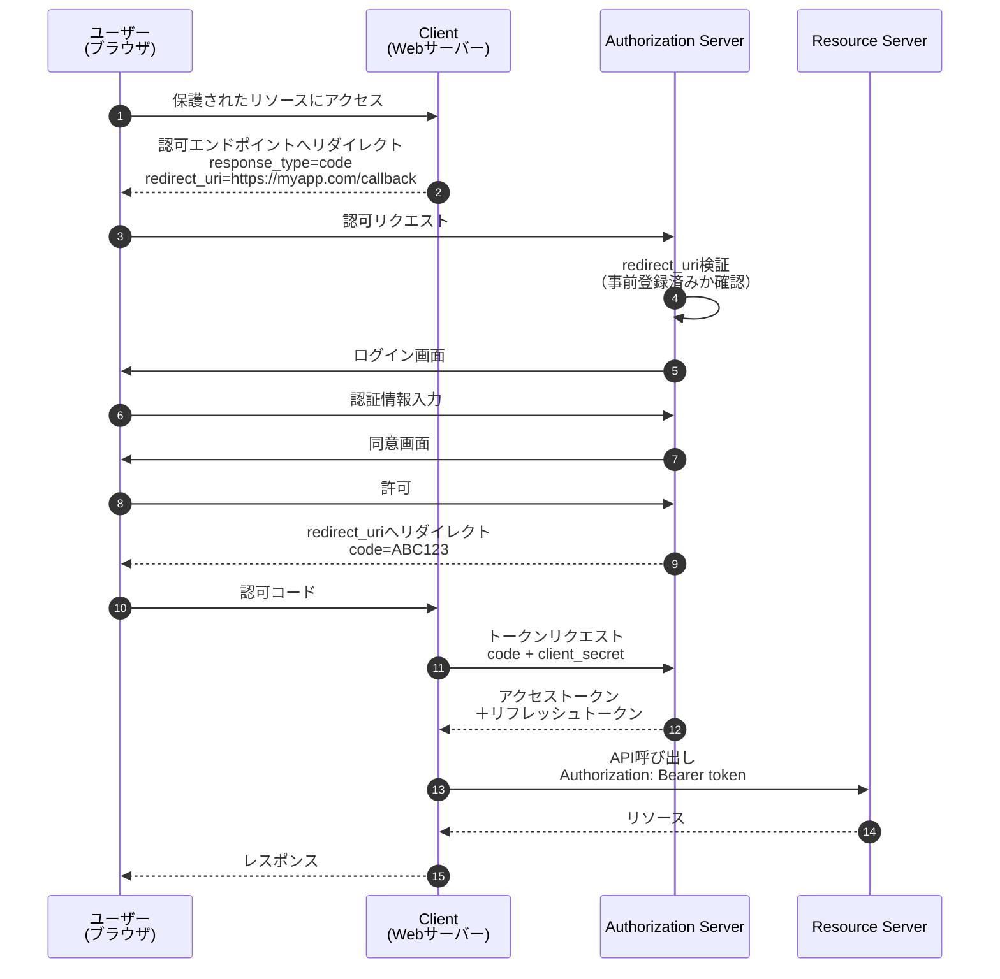
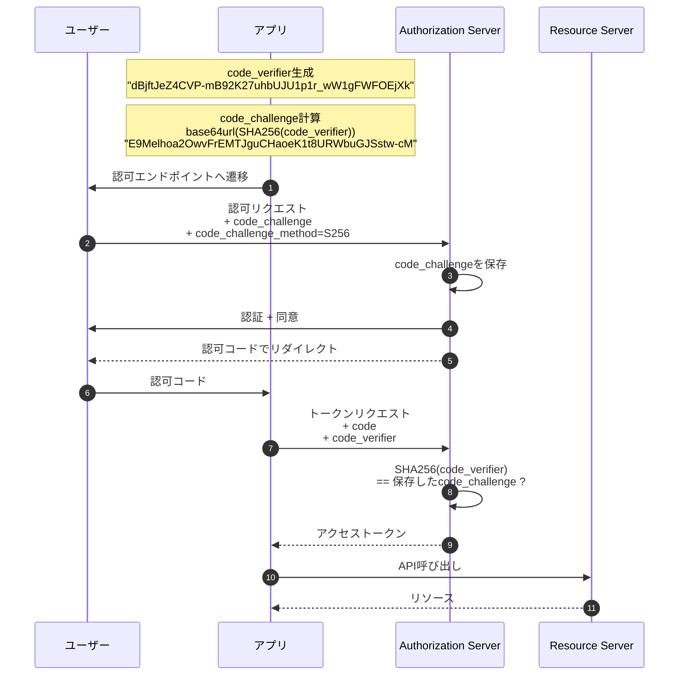
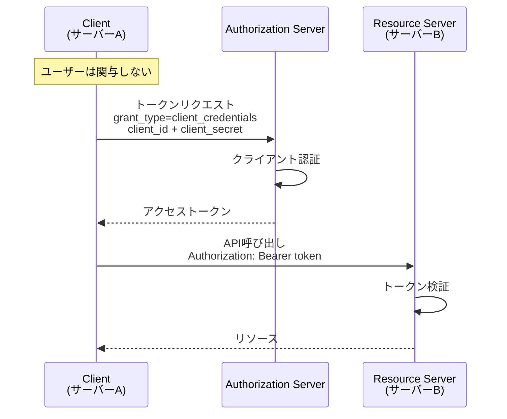
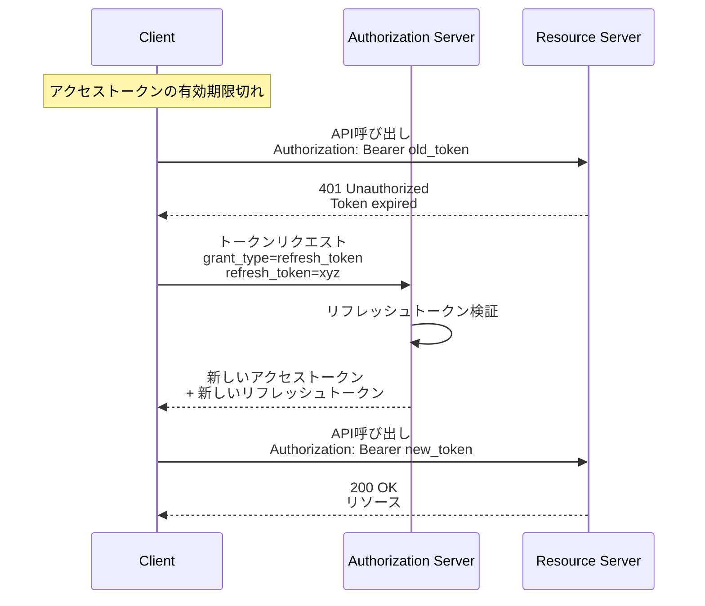

OAuth2.0には複数の認可フロー（Grant Types）があり、クライアントのタイプや使用シーンに応じて適切なものを選択します。

## Grant Typesの全体像

### 4つの現在推奨されているフロー

- **Authorization Code Grant**: Webアプリ向け(サーバー環境あり)
- **Authorization Code Grant + PKCE**: SPA・モバイルアプリ向け(クライアント環境のみ)
- **Client Credentials Grant**: サーバー間通信向け
- **Refresh Token Grant**: トークン更新時に使用

### 非推奨のGrant Types

以下のフローは現在非推奨とされており、基本的には使用すべきではありません。

- **Implicit Grant**: アクセストークンがURLに含まれるためセキュリティリスクが高い → **Authorization Code + PKCE** を使用
- **Resource Owner Password Credentials Grant**: パスワードをクライアントに渡すためOAuth2.0の本来の目的に反する → **Authorization Code + PKCE** を使用

ただし、クライアントが完全に信頼できる自社の公式アプリや社内システム等では使用することができます。

## 1. Authorization Code Grant（認可コードグラント）

**Confidential Client**（サーバーサイドでclient_secretを安全に保管できるアプリ）向けの認可フローです。

### フロー図



セキュリティポイントは以下の通りです。

- client_secretは絶対に漏らさない
- stateパラメータでCSRF対策
- redirect_uriの厳格な検証
  - 認可サーバーに事前登録しておき、完全一致のみ許可する。

## 2. Authorization Code Grant + PKCE

client_secretを安全に保管できない**Public Client**（SPA、モバイルアプリ）の場合に使用される認可フローです。

### PKCEとは？

**PKCE（Proof Key for Code Exchange、ピクシーと読む）**は、client_secretを安全に保管できない**Public Client**（SPA、モバイルアプリ）のためのセキュリティ拡張です。

```javascript
// SPAでclient_secretを使うとソースコードに露出
const CLIENT_SECRET = 'super_secret_xyz' // 誰でも見ることができる

// モバイルアプリでも同様
// アプリをリバースエンジニアリングされたりするとバレる
```

PKCEは、**動的に生成される秘密鍵**を使って認可コードを保護します。

### フロー図



セキュリティポイントは以下の通りです。

- code_challenge_methodはS256を使用

  ```javascript
  // 推奨: SHA256ハッシュ
  code_challenge_method: 'S256'

  // 非推奨: プレーンテキスト（ハッシュなし）
  code_challenge_method: 'plain'
  ```

- code_verifierは十分にランダムにする
- code_verifierは一度しか使わない
  - トークン取得後は破棄する

## 3. Client Credentials Grant

ユーザーの代理ではなく、**クライアント自身**がリソースにアクセスする認可フローです。サーバー間通信（Machine-to-Machine）で主に使用されます。
このフローは、ユーザーの認証はせず、クライアントアプリケーションの認証のみを行なうのが特徴です。

### フロー図



### 使用ケース

- マイクロサービス間の通信などのサーバー間通信

## 4. Refresh Token Grant

有効期限が切れたアクセストークンを、リフレッシュトークン(チャプター2参照)を使って更新する認可フローです。

### フロー図



## 5. Resource Owner Password Credentials Grant（パスワードフロー）

パスワードをクライアントに渡すためOAuth2.0の本来の目的に反します。そのため、基本的には非推奨ですが、限定的な状況でのみ使用可能な認可フローです。たとえば以下のような条件なら使用してもOKです。

### 使用可能な条件

- クライアントが完全に信頼できる（自社の公式アプリ）
- 社内システム・APIサーバーのやり取り

なお、OAuth 2.1では仕様からそもそも省略されるようです。

### FastAPIドキュメントの話

※興味がない人は飛ばしてください

FastAPIの公式チュートリアルで使われている認証方式は、まさにこの**パスワードフロー**です。

:::message
FastAPIのドキュメント「Security First Steps」で紹介されているOAuth2で認証を構築できますと書いてあり、混乱しました。ただ、パスワードのハッシュでやるレガシーなものと変わらなくない？　と思ったのです。ただ、今思えばここでの話は、このResource Owner Password Credentials Grant（パスワードフロー）を実装したものです。

**FastAPI Security - First Steps**
https://fastapi.tiangolo.com/ja/tutorial/security/first-steps/
:::

たとえば、社内システムとして以下のような構成であれば、パスワードフローを使っても問題ありません

- **バックエンド**: FastAPIでこの認証方式を実装
- **フロントエンド**: バックエンドのAPIに対応した認証フロー（React等）
- **対象ユーザー**: 社内の従業員のみ（完全に信頼できる環境）

この場合、ユーザーは自社のシステムにパスワードを入力するため、サードパーティへのパスワード漏洩リスクがなく、OAuth2.0の本来の目的と矛盾しません。

## 次のステップ

次のチャプターでは、OAuth2.0を認証に拡張したOpenID Connectについて学びます。
