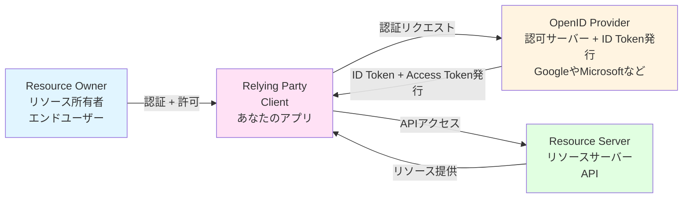
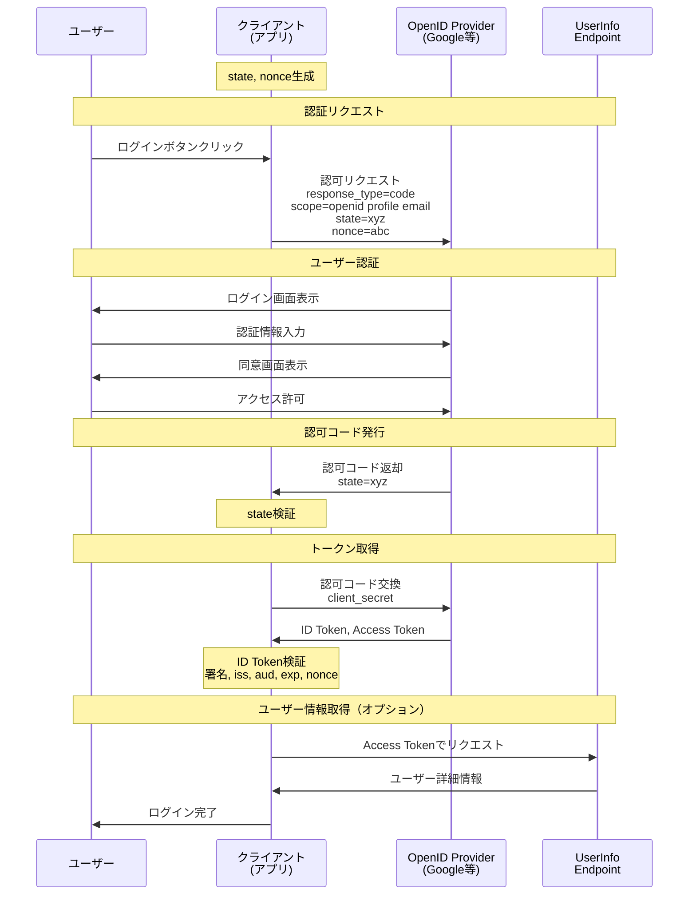

## OpenID Connectとは？

OpenID Connect（OIDC）は、OAuth2.0の上に認証のプロセスを追加して構築された認証認可のための標準プロトコルです。

OAuth2.0では**アクセストークン**を使ってAPIへの認可を行なっていましたが、このトークンには**「誰なのか」という情報が含まれていませんでした**。

OpenID Connectは、これに加えて**ID Token**という新しいトークンを導入することで、以下の情報を扱えるようにしました：

- **誰なのか**（ユーザーID、メールアドレス、名前など）
- **いつ認証されたか**（認証時刻）
- **どのアプリ向けに発行されたか**（audience）

つまり、OAuth2.0が「**何ができるか**」を扱うプロトコルだとすると、OpenID Connectは「**誰なのか**」も扱えるように拡張したプロトコルです。

## OpenID Connectの登場人物

OpenID ConnectはOAuth2.0の上に構築されているため、基本的な登場人物はOAuth2.0と同じです。ただし、認証機能が追加されているため、役割が少し拡張されています。



:::message
**OAuth2.0との違い:**

- **Client** → **Relying Party（RP）**: OpenID Connectでは、クライアントをRelying Partyと呼びます（同じ意味）
- **Authorization Server** → **OpenID Provider（OP）**: 認可サーバーに加えて、ID Tokenを発行する役割が追加されます
- **トークン**: Access Tokenに加えて、**ID Token**が発行されるようになります

:::

### 1. Resource Owner（リソース所有者）

- **役割**: 保護されたリソースの所有者であり、認証される主体
- **具体例**: あなた（エンドユーザー）

OAuth2.0と同じく、クライアントにリソースへのアクセスを許可します。加えて、OpenID Connectでは**自分が誰であるかの情報**もクライアントに提供することを許可します。

### 2. Relying Party（クライアント）

- **役割**: ユーザーの認証を依頼するアプリケーション
- **具体例**: あなたが開発するWebアプリ、モバイルアプリ

OAuth2.0の「Client」と同じですが、OpenID ConnectではRelying Party（RP）と呼ばれます。「認証をOpenID Providerに依頼する側」という意味です。

**重要な実装上の注意:**

実際にSSOを実装する際、あなたが作るアプリは**OpenID Providerにはなりません**。あなたのアプリはRelying Party（クライアント）として実装します。

```text
ユーザー → あなたのアプリ（RP） → Google等のOpenID Provider → あなたのアプリに戻る
```

つまり、GoogleやMicrosoftなどの既存のOpenID Providerを使い、あなたのアプリはそれらを利用する側（クライアント）として実装すればOKです。自分でOpenID Providerを構築する必要はありません。

### 3. OpenID Provider（IdP）

- **役割**: ユーザーを認証し、ID TokenとAccess Tokenを発行
- **具体例**: Google、Microsoft、Auth0、Okta

OAuth2.0の認可サーバー（Authorization Server）の役割に加えて、以下の機能が追加されます：

- **ID Tokenの発行**: ユーザーの認証情報を含むトークン
- **UserInfoエンドポイント**: ユーザー情報を提供する標準APIエンドポイント
- **Discovery Document**: OpenID Providerの設定情報を公開

:::message
**注意**: 実際のサービスでは、OpenID Provider（認可サーバー）とリソースサーバーは同じ組織（例：Google）が提供していることが多いです。そのため、ユーザーからは同じものに見えますが、OpenID Connectの仕組み上は役割が異なります。

例：Googleの場合

- OpenID Provider: `https://accounts.google.com`（認証 + トークン発行）
- リソースサーバー: `https://www.googleapis.com`（APIを提供）

また、OpenID ProviderはAuthorization Serverとしての役割も兼ねているため、OAuth2.0のAccess Tokenも発行します。
:::

### 4. Resource Server（リソースサーバー）

- **役割**: 保護されたリソースを提供するサーバー
- **具体例**: Google Calendar API、Google Drive API、Microsoft Graph API

OAuth2.0と同じく、Access Tokenを検証してリソースを返す役目です。OpenID Connectの認証フローで発行されたAccess Tokenも使用できます。

## OpenID Connectのフロー

OpenID Connectは、OAuth2.0の**Authorization Code Grant**を基本としたフローを使用します。通常のOAuth2.0フローとの違いは、スコープに`openid`を含めることと、トークンレスポンスにID Tokenが追加されることです。

### Authorization Code Flow

以下は、OpenID Connectを使った典型的な認証フローです：



**フローの重要なポイント:**

1. **認可リクエスト時**: `scope=openid`を含めることが必須。また、CSRF対策の`state`とリプレイ攻撃対策の`nonce`を生成してセッションに保存
2. **認可コード受け取りとき**: `state`を検証してCSRF攻撃を防ぐ
3. **トークン取得時**: 認可コードと`client_secret`を交換して、ID TokenとAccess Tokenを取得
4. **ID Token検証**: 署名、発行者（iss）、対象者（aud）、有効期限（exp）、nonceを検証
5. **ユーザー情報取得**: 必要に応じてUserInfoエンドポイントから詳細情報を取得

このフローが完了すると、クライアントはユーザーが誰であるか（認証）を確実に知ることができ、またユーザーの許可した範囲でAPIにアクセス（認可）することもできます。

## OAuth2.0の問題とOpenID Connectによる解決

前のチャプターで学んだように、OAuth2.0には認証に使う際の問題があります：

**OAuth2.0の3つの問題:**

1. **アクセストークンは「誰」を証明しない**: ユーザーID、認証時刻などの情報が含まれない
2. **トークンのすり替え攻撃が可能**: どのクライアント向けのトークンかを検証できない
3. **仕様が定義していない**: ユーザー情報取得方法が標準化されていない

**OpenID Connectの解決策:**

OpenID Connectは、これらの問題を**ID Token**という新しいトークンの追加で解決します。

```javascript
// OpenID Connectの場合
{
  "access_token": "ya29.a0AfH6SMBx...",  // APIアクセス用
  "id_token": "eyJhbGciOiJSUzI1NiIs...",  // ← 認証情報（新たに追加）
  "token_type": "Bearer",
  "expires_in": 3600
}
```

**ID Tokenに含まれる情報:**

```javascript
{
  "iss": "https://accounts.google.com",           // 発行者
  "aud": "abc123xyz.apps.googleusercontent.com",  // 対象者（どのアプリ向けか）
  "sub": "248289761001",                          // ユーザーID
  "exp": 1701238167,                              // 有効期限
  "auth_time": 1701234567,                        // 認証時刻
  "nonce": "xyz789",                              // リプレイ攻撃対策
  "name": "田中太郎",
  "email": "tanaka@example.com"
}
```

これにより、以下が可能になります：

- **audience（aud）検証**: トークンが自分のアプリ向けかを確認できる→トークンのすり替え攻撃を防ぐ
- **nonce検証**: 過去のトークンの再利用を防ぐ→リプレイ攻撃を防ぐ
- **標準クレーム**: どのOpenID Providerでも同じ方法でユーザー情報を取得できる

## 実際にSSOを実装する際には

ここまで読めばわかると思いますが、実際にSSOを実装する際は、基本的に**OpenID Connect Client（Relying Party）**として実装します。

### 一般的なユースケース: クライアントとして実装

ほとんどの場合、あなたが作るアプリは既存のOpenID Provider（Google、Microsoft、Auth0等）を利用する**クライアント側**として実装します。

### 特殊なケース: OpenID Providerとして実装

ただし、「{あなたのアプリ名}でログイン」という機能を他のシステムやアプリに提供したい場合は、あなたのアプリを**OpenID Provider**として実装する必要があります。

**例:**

- 社内の複数のシステムを、自社の独自認証基盤で統合したい
- 自社のSaaSプロダクトを使って、顧客の他のアプリにログインできるようにしたい

この場合は、以下を実装する必要があります：

- ID Tokenの発行
- UserInfoエンドポイントの提供
- Discovery Documentの公開
- トークンの署名と検証

ただし、このような要件がない限り、一般的にはOpenID Connect Clientとして実装するだけで十分です。

## 次のステップ

次のチャプターでは、ID Tokenで使用されるJWT（JSON Web Token）について詳しく学びます。
