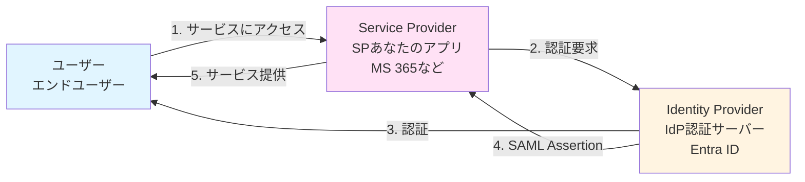
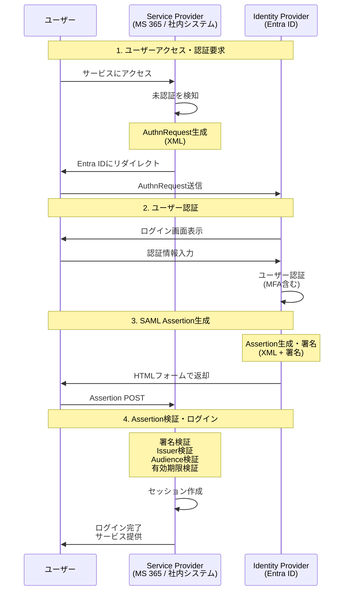

## SAMLとは

**SAML (Security Assertion Markup Language)** は、異なるドメイン間で**認証情報**と**認可情報**を安全に交換するための**XMLベース**の標準規格です。

SAMLの特徴はいくつかあります。まず、メッセージがすべてXML形式で、署名や暗号化もXML規格に準拠しています。そして、主に企業向け（Enterprise）のB2BやSSOで使用されており、Microsoft Entra IDやOkta、Auth0などが代表的なサービスです。

一方で、SAMLはXMLが大きくブラウザベースの仕組みを前提としているため、モバイルアプリやSPA（シングルページアプリケーション）には不向きです。

### SAMLの主な用途

SAMLは主に以下のような場面で使われています。

**エンタープライズSSO（企業のシングルサインオン）** では、社内の統合認証システムとして活躍します。たとえば、1回のログインでMS 365、Salesforce、Slackなどすべてのサービスにアクセスできるようになります。

## SAMLとOAuth/OpenID Connectの違い

### 根本的な違い

SAMLとOAuth/OpenID Connectは目的や形式が異なります。

**SAML** は認証（Authentication）と認可（Authorization）の両方を扱い、データ形式はXMLです。主にエンタープライズSSOで使われ、2002年から存在する比較的古い技術です。

**OAuth 2.0** は認可（Authorization）のみを扱い、データ形式はJSON（API）です。主にAPI連携やサードパーティアプリへの権限委譲で使われ、2012年に登場しました。

**OpenID Connect** はOAuth2.0の上で認証（Authentication）+認可を扱い、データ形式はJSON（JWT）です。モダンなログインやモバイルアプリ、SPAで使われ、2014年に登場した比較的新しい技術です。

## SAMLの主要概念

### 登場人物（エンティティ）

SAMLには主に3つの登場人物がいます。

#### Service Provider（SP）- サービス提供者

Service Provider（SP）は、ユーザーがアクセスしたいサービスのことです。

SPの役割は以下の通りです：

1. ユーザーからのアクセスを受け取る
2. IdPに認証を依頼する（AuthnRequest送信）
3. IdPからの応答（Assertion）を検証する
4. ユーザーをログイン状態にする

SPには**2つのパターン**があります。

##### パターン1: 既存のSaaS（設定のみ）

既存のSaaSサービス（Microsoft 365、Salesforce、Slack、Zoom、AWSなど）を使う場合は、コーディングは不要です。管理画面でEntra IDとの連携を設定するだけで、SAML設定（EntityID、ACS URLなど）を入力すれば完了します。

**MS 365の設定例:**

MS 365でSAMLを設定する手順は以下の通りです：

1. Entra ID管理センターで「エンタープライズアプリケーション」を開く
2. 「Microsoft 365」を選択
3. 「シングルサインオン」→「SAML」を選択
4. 基本的なSAML構成を入力:
   - 識別子（エンティティID）: https://your-tenant.onmicrosoft.com
   - 応答URL（ACS URL）: https://login.microsoftonline.com/login.srf
5. 保存して完了

このように、コーディング不要で設定だけでSSO連携が完了します。

##### パターン2: 社内システム（SP実装）

Entra IDでログインする社内Webアプリや業務システム、カスタム開発したポータルサイトなどを作る場合は、SAMLライブラリを使ってSP側を実装する必要があります。Entra IDから送られるSAML Assertionを検証し、ユーザー情報を取得してセッションを作成します。

**Entra ID側の設定:**

Entra ID側では以下の設定を行ないます：

1. Entra ID管理センターで「アプリの登録」を開く
2. 「新規登録」→「SAML統合アプリケーション」を選択
3. 基本情報を入力:
   - 名前: 社内システム
   - サインオンURL: https://your-app.example.com/login
   - 識別子（エンティティID）: https://your-app.example.com
   - 応答URL（ACS URL）: https://your-app.example.com/login/callback
4. 証明書をダウンロードしてアプリに設置
5. ユーザーをアプリに割り当て

これであなたの社内システムがSPとして機能するようになります。

#### Identity Provider（IdP）- 認証提供者

Identity Provider（IdP）は、ユーザーの認証を行なうサーバーです。

IdPの役割は以下の通りです：

1. SPからの認証要求を受け取る
2. ユーザーを認証する（ID/パスワード、MFAなど）
3. SAML Assertionを生成・署名する
4. SPにAssertionを送信する

代表的なIdPには、Microsoft Entra ID（旧Azure AD）、Okta、Auth0、Google Workspace、OneLoginなどがあります。

:::message
**実装について:**

ほとんどの場合、あなたが実装するのは**SP側**です。IdP（Entra IDなど）は既存のサービスを使います。

IdPを自分で実装するのは、「{あなたの会社名}でログイン」という機能を他のシステムに提供したい場合のみです。これは非常にレアなケースです。
:::

## SAMLの仕組み（SP-Initiated Flow）

### シーケンス図

### フローの詳細

SAMLのSP-Initiated Flow（SPから開始するフロー）は、以下のステップで進みます：

1. ユーザーがSP（MS 365や社内システム）にアクセス
2. SPが未認証を検知し、AuthnRequest（認証要求）を生成
3. ユーザーがEntra IDにリダイレクト
4. Entra IDでユーザーがログイン・MFA認証
5. Entra IDがSAML Assertion（署名付きXML）を生成
6. ユーザーがHTMLフォームでSPにPOST
7. SPがAssertion検証してログイン完了

## 次のステップ

次のチャプターでは、Cookieとセッションについて学びます。
