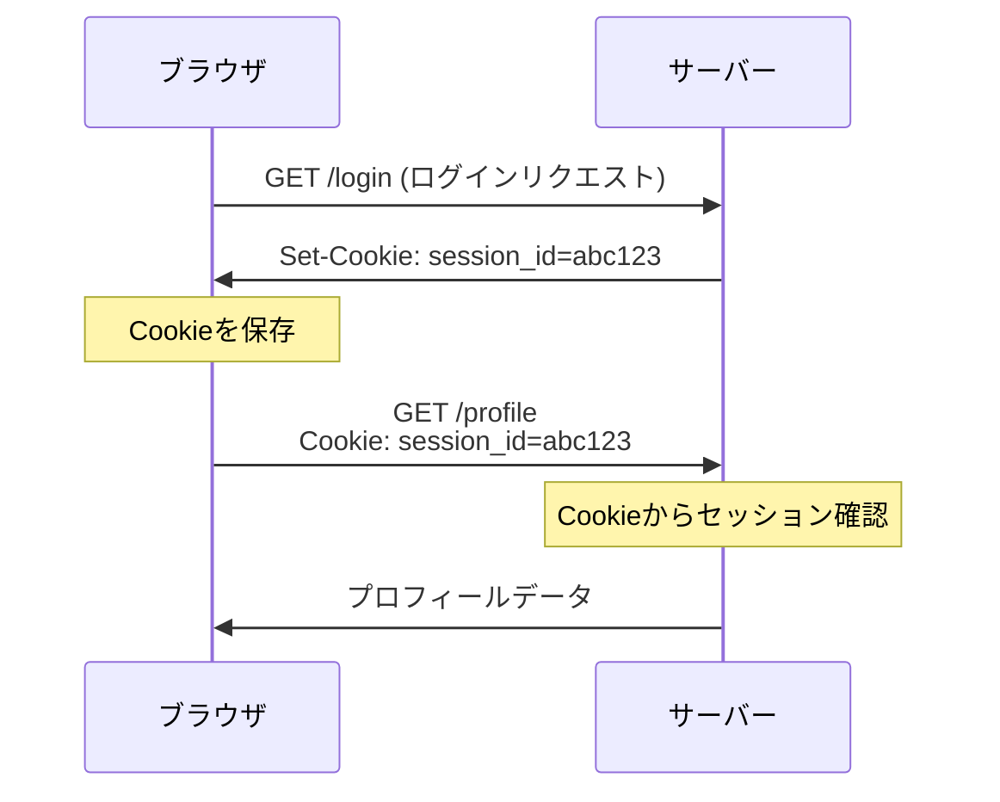
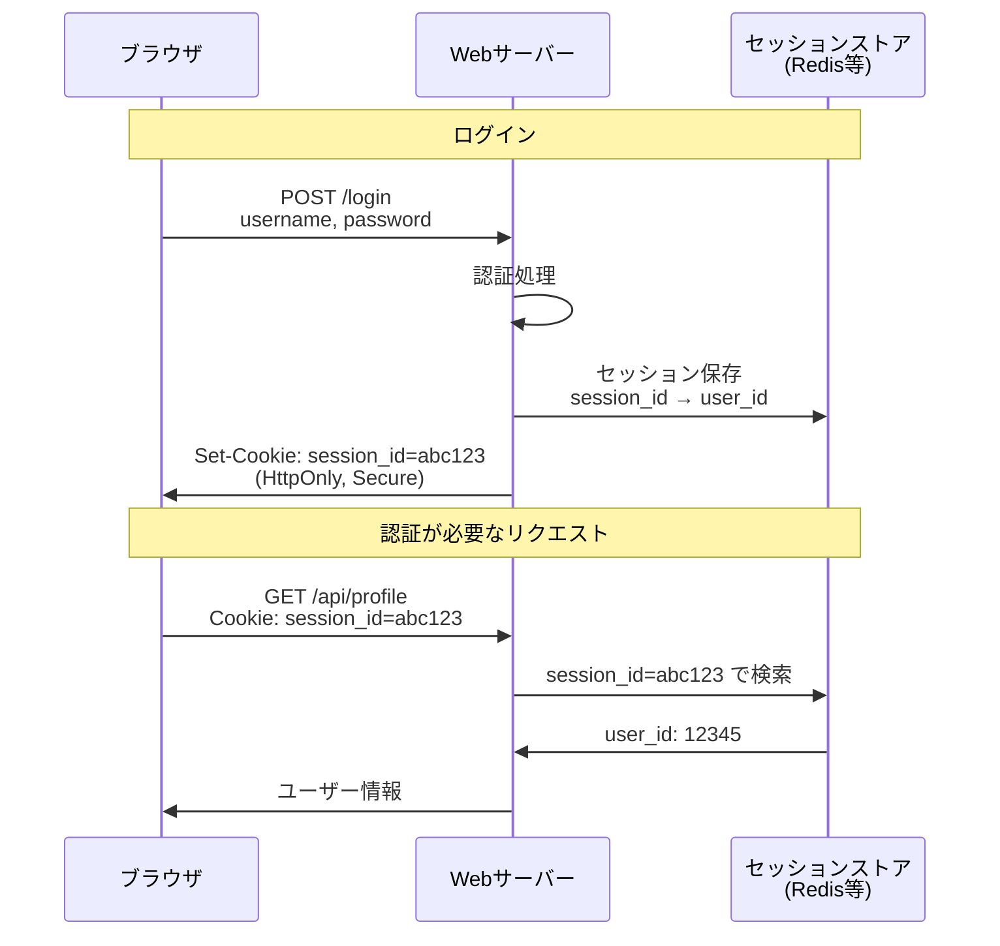
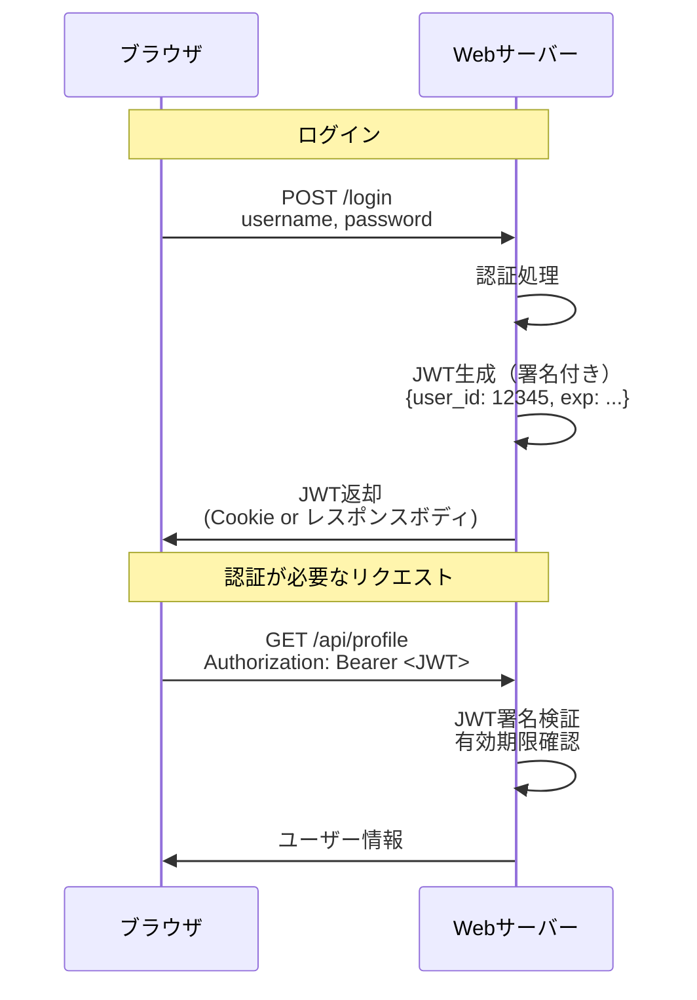

## この章について

ここまでOAuth2.0やOpenID Connectといった**認証・認可プロトコル**について学んできました。これらはあくまで「トークンをどう発行して検証するか」という標準的な仕組みです。

しかし、実際にWebアプリケーションを作る際には、もう1つ重要な問題があります。それが「認証状態をどう管理・保持するか」です。

:::message
**前章までとの違い:**

- **前章まで**: 認証・認可の**プロトコル**（OAuth2.0、OpenID Connect等）
- **この章**: 認証状態の**管理方法**（Cookie、セッション、トークン保存）

この章では、プロトコルの話から少し離れて、ブラウザでの認証状態管理という実装レベルの話をします。
:::

## Cookieとは？

**Cookie**は、**ブラウザにデータを保存する仕組み**です。サーバーが`Set-Cookie`ヘッダーでブラウザにデータを保存させ、ブラウザは次回以降のリクエストで自動的にそのデータを`Cookie`ヘッダーに含めて送信します。

### Cookieの基本的な動作



### Cookieの主な属性

Cookieにはさまざまな属性を設定できます：

```http
Set-Cookie: session_id=abc123; HttpOnly; Secure; SameSite=Lax; Max-Age=3600; Path=/
```

| 属性       | 説明                               |
| ---------- | ---------------------------------- |
| `HttpOnly` | JavaScriptからアクセス不可         |
| `Secure`   | HTTPS通信でのみ送信                |
| `SameSite` | クロスサイトリクエストでの送信制御 |
| `Max-Age`  | 有効期限（秒単位）                 |
| `Path`     | Cookieを送信するパス               |
| `Domain`   | Cookieを送信するドメイン           |

:::message
**重要:** 認証に使うCookieには、最低限`HttpOnly`と`Secure`、`SameSite`を設定するのが推奨されます。
:::

### 重要：Cookieは単なるデータ保存の仕組み

「Cookie認証」という言葉がよく使われるため勘違いされがちですが、**Cookieはただのデータ保存の仕組みに過ぎません**。認証の仕組み自体ではありません。

ブラウザの開発者ツールで実際に確認できます：

1. 開発者ツールを開く（F12キー）
2. `Application`タブ → `Cookies`を選択
3. ドメインを展開すると、Name-Value形式でデータが保存されているのが見える

```text
例：Googleにログインしている場合
Name: SID
Value: AQGOoOGmxKX...（長いランダム文字列）

Name: SSID
Value: AZO9PTj8X...（別のランダム文字列）
```

このように、Cookieに保存されているのは**ただの文字列**です。

:::message

- ❌「Cookie認証」という特別な認証方式がある
- ✅ 正確には「Cookieを使ってセッションIDやトークンを保存し、それを認証に利用している」

Cookieは保存場所の選択肢の1つに過ぎず、認証ロジック自体とは別物です。
:::

## セッション管理の2つの方式

Webアプリケーションでユーザーの認証状態を管理する方法は、大きく分けて2つあります：

### 1. セッションIDベース（Cookie + サーバーサイドセッション）

サーバー側でセッション情報を保持し、ブラウザにはセッションIDだけを持たせる方式です。



### 2. トークンベース（JWT等）

サーバーが署名付きトークン（JWT等）を発行し、ブラウザがそれを保存する方式です。



## トークンの保存場所とセキュリティ

トークンベース認証を採用する場合、トークンをどこに保存するかが重要です。

### 1. LocalStorage / SessionStorage

```javascript
// 非推奨: XSSに脆弱
localStorage.setItem('access_token', token)

// JavaScriptから読み取り可能
const token = localStorage.getItem('access_token')
```

**リスク:**

- XSS攻撃でトークンが盗まれる
- JavaScriptから自由にアクセスできてしまう

### 2. HttpOnly Cookie

```javascript
// サーバーサイド
res.cookie('access_token', token, {
  httpOnly: true, // JavaScriptからアクセス不可
  secure: true, // HTTPS必須
  sameSite: 'lax', // CSRF対策
  maxAge: 3600000 // 1時間
})
```

**リスク:**

- CSRF攻撃のリスク（SameSite属性で軽減可能）

一方で以下のような利点があります。

- XSSに強い（JavaScriptからアクセス不可）
- SameSite属性でCSRF対策

### 3. メモリ内保存（SPA推奨）

```javascript
// 推奨: メモリ内に保存（グローバル変数やReact state等）
let accessToken = null

function setToken(token) {
  accessToken = token
}

// リフレッシュトークンはHttpOnly Cookieに保存
```

**メリット:**

- XSSでも直接的には盗まれにくい
- ページ再読み込み時に消える（セキュリティ向上）

**デメリット:**

- ページ再読み込み時にトークンが消える（リフレッシュトークンで再取得が必要）

## 参考

本章の内容は以下の記事を参考にしています。あわせてご確認ください。
https://zenn.dev/takayuu/articles/session-token-568f6e05838152

## 本書のまとめ

ここまで、認証と認可について、基礎から実装まで幅広く学んできました。

**第1章**では、認証（誰か）と認可（何ができるか）という基本概念を理解しました。

**第2章〜第4章**では、モダンな認証・認可プロトコルを学びました：

- **OAuth 2.0**: 認可のためのプロトコル。パスワードを共有せず、限定的な権限を委譲する仕組み
- **OpenID Connect**: OAuth 2.0を拡張した認証・認可プロトコル。ID Tokenによる認証情報の標準化
- これらのプロトコルがどのようにトークンを発行・検証するかを理解

**第5章**では、JWTが単なるデータフォーマットの仕様であり、認証プロトコルではないことを学びました。

**第6章**では、エンタープライズで使われるSAMLについて学びました。

**第7章**では、プロトコルとは別の視点として、認証状態の管理方法を学びました。Cookieは単なるデータ保存の仕組みであり、セッションIDベースかトークンベースかは実装の選択肢であることを学びました。

認証・認可は複雑な領域ですが、それぞれの技術が「何を解決するために作られたか」「本質的には何を意味するか」を理解することで、適切に使い分けられるようになります。

セキュリティは常に進化する分野です。本書で学んだ基礎知識をもとに、最新のベストプラクティスを学び続けてください。
